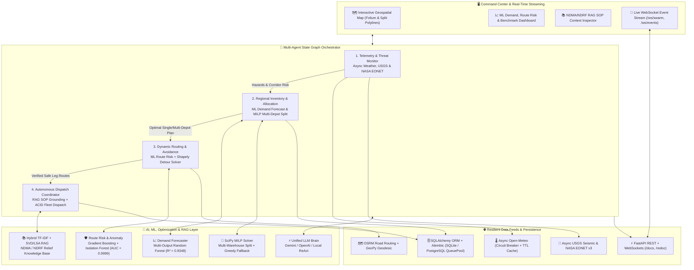

# 🚨 Autonomous Emergency Response & Supply Chain Logistics Swarm

[](https://www.python.org/)
[](https://pytest.org/)
[](https://mypy-lang.org/)
[](https://docs.astral.sh/ruff/)
[](http://localhost:8000/docs)
[](LICENSE)

An enterprise-grade, **autonomous multi-agent AI system** for disaster-relief supply chain resilience across **20 Indian national logistics corridors**. Built with **LLM tool-calling ReAct agents** (Google Gemini, OpenAI, and an offline Autonomous Local ReAct Engine), **SciPy MILP multi-warehouse split fulfillment**, **hybrid TF-IDF/LSA RAG** over NDMA/NDRF operational SOPs, **ML demand forecasting & corridor risk scoring**, **self-correcting Shapely/OSRM detour routing**, **async telemetry ingestion with circuit breakers**, and **real-time FastAPI WebSocket streaming**.

---

## 🏗️ System Architecture



---

## 🔄 How It Works: Autonomous Agent Decision Flow

1. **Telemetry & Threat Monitoring (`agents/telemetry_agent.py`)**: Polls live weather concurrently across 20 logistics hubs (`asyncio` + `httpx.AsyncClient` guarded by circuit breakers, token-bucket rate limiters, and TTL caches) alongside live **USGS** seismic and **NASA EONET v3** disaster feeds, persisting active hazard zones to the database.
2. **ML Demand & MILP Split Allocation (`agents/inventory_agent.py`)**: Predicts 7-category relief demand using the Random Forest forecaster, ranks warehouses by **ellipsoidal GeoPy geodesic distance**, enforces reserve-floor constraints, and runs **SciPy MILP optimization** (`scipy.optimize.milp`, with deterministic greedy fallback) whenever demand exceeds any single depot's capacity.
3. **Self-Correcting Routing & ML Risk (`agents/routing_agent.py`)**: Queries **OSRM** road geometry per depot leg, evaluates corridor weather risk via **Gradient Boosting + Isolation Forest**, checks **Shapely** polygon collisions (bypassing terminal zones when origin or ground zero lies inside a hazard), and synthesizes perpendicular detour waypoints around intermediate hazards.
4. **RAG-Grounded Dispatch & Carbon Audit (`agents/dispatch_agent.py`)**: Retrieves top-$k$ **NDMA/NDRF SOPs** via hybrid TF-IDF + TruncatedSVD/LSA cosine search, commits **ACID multi-depot inventory deductions**, assigns capacity-matched vehicles, computes fuel burn/CO₂ emissions, broadcasts real-time events over WebSockets, and records run KPIs via `evaluation.metrics`.

---

## 📊 Quantitative Benchmarks & Model Performance

Measured directly on the built-in 5-scenario evaluation suite (`python -m evaluation.benchmark`):

| Metric | Measured Value | Notes |
|---|---|---|
| **Benchmark Pass Rate** | **`100.0%` (5 / 5 scenarios)** | Chennai Cyclone, Pune Landslide, Guwahati Flood, Delhi Seismic, Vizag Split Surge |
| **Median Latency (P50)** | **`1857.98 ms`** (~1.86 s) | End-to-end 4-agent execution across 5 scenarios (`661.69 ms` warm minimum) |
| **Tail Latency (P95 / P99)** | **`10409.84 ms` / `12069.35 ms`** | Includes uncached cold Open-Meteo + OSRM network bootstrap |
| **Inventory Fulfillment Rate** | **`100.0%` mean** | Including `BM-05-VIZAG-SPLIT-SURGE` (**1,700 / 1,700 units** across **4 depots** in `2112.26 ms`) |
| **Route Optimality Ratio** | **`1.569` mean** (`1.128` on Vizag surge) | Actual OSRM road km vs. direct ellipsoidal geodesic km |
| **Decision Accuracy Score** | **`100.0%` mean** | Validated tool execution, reserve compliance (`100.0%`), and zero agent errors |
| **ML Demand Forecaster** | **$R^2 = 0.9348$**, MAE = `468.55` units | 500 test samples (`water_purification` $R^2 = 0.955$, `medical_kits` $R^2 = 0.953$) |
| **ML Route Risk & Anomaly** | **ROC-AUC = `0.9999`** | 600 test samples across 9 meteorological & distance features |
| **Automated Test Suite** | **`49 / 49` passed (`70%` coverage)** | Unit + FastAPI + WebSocket + MILP + Alembic + Async resilience (`pytest`) |
| **Static Analysis** | **`0` mypy errors, `0` ruff issues** | Verified across 38 typed source modules |

---

## ⚙️ Core Technical Highlights

- **Multi-Warehouse MILP Split Optimization (`database/db_manager.py`)**: Solves mixed-integer linear programs to split massive relief surges across up to $k$ regional depots minimizing weighted cargo-distance and mobilized depots, falling back automatically to greedy allocation if MILP is infeasible.
- **Hybrid Sparse + Dense RAG (`rag/retriever.py`, `rag/knowledge_base.py`)**: Combines TF-IDF lexical scoring (`ngram_range=(1, 2)`) with SVD/LSA semantic cosine similarity over curated NDMA/NDRF/Cold-Chain/UNJLC emergency SOPs in sub-5ms retrieval latency.
- **Resilience Primitives (`services/circuit_breaker.py`, `services/cache_and_ratelimit.py`)**: Thread-safe `CLOSED → OPEN → HALF_OPEN` circuit breakers, thread-safe LRU TTL caches, and token-bucket rate limiters protect external API clients with clean geodesic/baseline offline fallbacks.
- **Dual Database Backend + Migrations (`alembic/`, `database/db_manager.py`)**: Seamless switching between local SQLite (`QueuePool`) and production **PostgreSQL** (`pool_size`, `max_overflow`, `pool_pre_ping`, `pool_recycle`) via `DATABASE_URL`, versioned with Alembic (`0001_initial_schema.py`) and managed via `session_scope()` / `get_db()`.
- **Unified Provider-Agnostic LLM Client (`llm/client.py`)**: Supports **Google Gemini**, **OpenAI**, and an **Autonomous Local ReAct Engine** that operates end-to-end with zero external API keys.

---

## 🌐 Interactive REST & WebSocket API

Start the FastAPI microservice (`uvicorn services.supplier_api:supplier_app --host 0.0.0.0 --port 8000`) to explore interactive OpenAPI v2.0.0 docs with Pydantic request/response schemas and live examples:

- **Swagger UI**: `http://localhost:8000/docs`
- **ReDoc**: `http://localhost:8000/redoc`

### Key Endpoints
- **Warehouses & Inventory**: `GET /api/warehouses`, `GET /api/warehouses/nearest`, `GET /api/warehouses/{warehouse_id}`, `GET /api/inventory/{warehouse_id}`, `GET /api/inventory/regional/{category}`, `POST /api/inventory/check`, `POST /api/inventory/deduct`, `POST /api/inventory/optimize-split`
- **Fleet, Dispatches & Hazards**: `GET /api/fleet/{warehouse_id}`, `POST /api/fleet/assign/{vehicle_id}`, `POST /api/fleet/release/{vehicle_id}`, `GET /api/dispatches`, `POST /api/dispatches`, `GET /api/hazard-zones`, `POST /api/hazard-zones`
- **RAG, Resilience & Streaming**: `POST /api/rag/query`, `GET /api/health`, `GET /api/health/resilience`, `WS /ws/swarm`, `WS /ws/events`

---

## 🚀 Quick Start

### Prerequisites
- Python 3.11+ (Tested on 3.11, 3.12, 3.14)
- Optional: Docker & Docker Compose, PostgreSQL 15+

### Local Setup

```bash
# 1. Create and activate a virtual environment
python -m venv venv
source venv/bin/activate  # On Windows: .\venv\Scripts\activate

# 2. Install runtime dependencies & editable package (eliminates sys.path hacks)
pip install -r requirements.txt
pip install --no-deps --no-build-isolation -e .

# 3. Initialize schema migrations (or let seed_all() initialize automatically)
alembic upgrade head

# 4. (Optional) Configure environment variables in .env
cp .env.example .env
# Optional keys: GEMINI_API_KEY, OPENAI_API_KEY, DATABASE_URL

# 5. Launch the Streamlit Command Center (http://localhost:8501)
streamlit run app.py
```

### Makefile Developer Commands

```bash
make install       # Install requirements & editable package
make install-dev   # Install linters, mypy, black, isort, pre-commit, pytest-cov
make run           # Launch Streamlit Command Center
make api           # Launch FastAPI REST + WebSocket server on port 8000
make test          # Run 49-test suite (pytest tests/ -v)
make cov           # Run test suite with line-by-line coverage report
make lint          # Run ruff check, black --check, and isort --check-only
make typecheck     # Run strict mypy check across all 38 source files
make benchmark     # Run 5-scenario latency & optimality benchmark suite
make migrate       # Apply Alembic migrations (alembic upgrade head)
make docker-up     # Start multi-container stack via Docker Compose
```

---

## 🐳 Docker Deployment

```bash
# Build and launch Streamlit UI + FastAPI microservice
docker compose up --build -d

# Check container status
docker compose ps

# UI: http://localhost:8501 | API Docs: http://localhost:8000/docs
```

---

## 📁 Repository Structure

```
Supply_chain_swarm/
├── .github/workflows/ci.yml        # CI pipeline: compile, ruff, mypy, ML train, pytest, Docker
├── .pre-commit-config.yaml         # Hooks: pre-commit-hooks, black, isort, ruff, mypy
├── agents/                         # Autonomous ReAct Agents (Telemetry, Inventory, Routing, Dispatch)
├── alembic/                        # Alembic schema migration scripts (0001_initial_schema.py)
├── database/                       # SQLAlchemy ORM models, pooling, ACID CRUD & MILP split solver
├── evaluation/                     # Run KPIs (evaluate_swarm_run) & 5-scenario benchmark runner
├── llm/                            # Unified Gemini / OpenAI / Local ReAct client, prompts & schemas
├── ml/                             # Random Forest Demand Forecaster & GBDT/IF Route Risk models
├── observability/                  # Structured JSONL trace logger & span latency metrics
├── rag/                            # NDMA/NDRF SOP corpus & Hybrid TF-IDF + SVD/LSA retriever
├── services/                       # Async Open-Meteo, OSRM+Shapely, USGS/EONET, Breaker/Cache, FastAPI
├── swarm/                          # State graph orchestrator, SwarmState TypedDict & 20 bound tools
├── tests/                          # Unit (38) & Integration (11) test suite
├── alembic.ini                     # Alembic configuration
├── app.py                          # Streamlit Live Command Center Dashboard
├── config.py                       # Logistics hubs, DB pooling, cache/breaker & threshold configs
├── Dockerfile & docker-compose.yml # Multi-service container definitions
├── Makefile                        # Developer task runner
├── pyproject.toml                  # Editable package metadata, pytest, ruff & mypy config
├── requirements.txt                # Pinned Python dependencies
└── LICENSE                         # MIT License
```

---

## 📜 License

Copyright (c) 2026 **Saath** — Distributed under the [MIT License](LICENSE).
